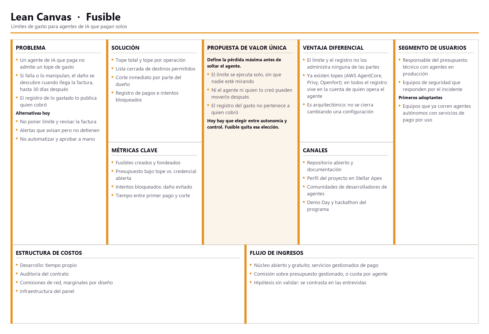
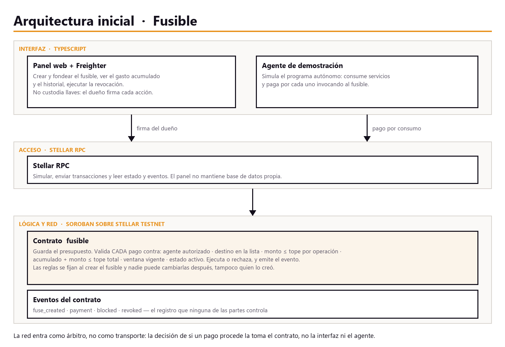

# Product Blueprint

**Nombre del proyecto:** Fusible

**Repositorio (enlace obligatorio):** [Pedronelbuiles/fusible](https://github.com/Pedronelbuiles/fusible)

---

## Contenido

1. Priorización de historias
2. Propuesta de valor
3. Flujo de usuario
4. Alcance del MVP
5. Lean Canvas
6. Backlog priorizado (Kanban)
7. Arquitectura inicial
8. Uso de Stellar y justificación

---

## 1. Priorización de historias

> Historias elegidas entre las que propuso el equipo y criterio con que se priorizaron. Son las que pasan al backlog. Extensión: breve.

**Criterio de priorización:** una sola pregunta ordena la lista — *¿esta
historia previene o detiene una pérdida?* Las que protegen van primero; las
que informan, después; las que ahorran esfuerzo administrativo quedan
fuera del backlog inicial. Entre las que protegen, primero las que actúan
sin que nadie esté mirando.

| Prioridad | Historia | Propuesta por | Por qué entra al backlog |
| :---: | --- | :---: | --- |
| 1 | Como responsable del presupuesto quiero fijar un tope de gasto antes de poner a operar un agente para que la pérdida máxima quede definida desde el primer minuto. | Pedro Builes | Es el producto. Sin tope, todo lo demás observa el daño pero no lo evita. |
| 2 | Como responsable del presupuesto quiero cortar en cualquier momento el acceso del agente a los fondos para detener un incidente sin apagar el sistema completo. | Pedro Builes | Es la contención. El tope define el peor caso; la revocación evita llegar a él. |
| 3 | Como responsable de seguridad quiero restringir a qué destinos puede pagar el agente para que un agente manipulado no pueda desviar fondos. | Pedro Builes | Limita *hacia dónde*. Sin ella, un agente comprometido agota el presupuesto en un solo pago, dentro de las reglas. |
| 4 | Como responsable de seguridad quiero consultar el registro de pagos e intentos bloqueados sin depender del proveedor que cobró. | Pedro Builes | Es la señal de pertinencia del Problem Brief hecha funcionalidad: evidencia que ninguna parte controla. |
| 5 | Como responsable del presupuesto quiero ver el gasto acumulado del agente mientras ocurre para no enterarme al cierre de facturación. | Pedro Builes | Cierra la fricción F3 y es la pantalla que vuelve demostrable el producto. |

**Quedan fuera del backlog inicial:** la integración de una sola llamada
para el desarrollador (historia 6) y la imputación por agente para finanzas
(historia 7). Ambas son valiosas, pero ninguna toca el riesgo: son adopción
y ahorro administrativo. Entran en la hoja de ruta de 30 días.

---

## 2. Propuesta de valor

> Qué resultado obtiene el usuario y por qué elegiría esta solución. En qué se diferencia de cómo resuelve hoy. Conecta con el usuario del Problem Brief. Extensión: 150–300 palabras en total.

**Usuario (del Problem Brief):**

| | |
|---|---|
| **Nombre** | Daniel |
| **Edad** | 34 años |
| **Contexto** | Líder técnico en una empresa de software en Medellín. Tiene tres procesos automáticos trabajando todos los días, aprueba el presupuesto y responde cuando el gasto se dispara |

**Necesidad:** cuando deja un proceso trabajando sin nadie encima, Daniel
necesita poner un límite de gasto que se cumpla solo, para poder dedicarse a
otra cosa sin arriesgar una pérdida sin techo.

**Qué resultado obtiene:** deja de elegir entre autonomía y control. Define
la pérdida máxima antes de soltar el proceso, y lo que pase después queda
dentro de un límite que fijó él y que después nadie puede mover, ni él
mismo.

**Por qué elegiría este producto:** porque *detiene* en vez de *avisar*, y
porque el registro no es de nadie. Una alerta llega cuando el gasto ya
ocurrió; un tope que se ejecuta solo impide que ocurra. Otros productos ya
detienen —AWS AgentCore, Privy, Openfort—, pero todos guardan el registro en
la cuenta de quien opera el agente. Daniel necesita poder mostrárselo a un
tercero sin que ese tercero tenga que creerle
(ver [`competencia.md`](../competencia.md)).

**En qué se diferencia de lo que hace hoy:** hoy tiene tres salidas y
ninguna sirve. No poner límite y revisar la cuenta al cierre es enterarse
hasta treinta días tarde. Poner alertas es reaccionar, no prevenir. No
automatizar es renunciar al beneficio y poner a una persona a aprobar cada
gasto.

> **Para** Daniel, que no puede acotar lo que gasta un proceso que trabaja
> solo, **Fusible es** un presupuesto con reglas que el proceso no puede
> cambiar, **que logra** que la pérdida máxima quede definida antes de
> empezar y que quede registro de todo lo gastado.

---

## 3. Flujo de usuario

> Recorrido de la persona por la solución de principio a fin, roles y puntos de interacción. Diagrama o secuencia numerada. Extensión: 150–300 palabras.

**Entrada.** Daniel tiene un proceso listo para trabajar solo y un monto que
está dispuesto a arriesgar. Está frente a su computador, con su billetera
instalada y el panel abierto. Ya sabe cuánto quiere gastar como máximo: lo
que no tiene hoy es dónde escribirlo para que se cumpla.

**Pasos intermedios.**

| # | Rol | Qué hace | Punto de interacción |
| :---: | :---: | --- | --- |
| 1 | Daniel | Se identifica como dueño del presupuesto | Panel + billetera |
| 2 | Daniel | Define el límite: cuánto en total, cuánto por vez, a quiénes se le puede pagar y hasta cuándo | Formulario del panel |
| 3 | Daniel | Deposita el monto que está dispuesto a arriesgar | Firma en la billetera |
| 4 | Daniel | Entrega al proceso el permiso acotado y lo deja trabajando | Configuración del proceso |
| 5 | Proceso | Paga cada servicio que necesita para hacer su tarea | Llamada al fusible |
| 6 | Fusible | Revisa cada pago contra el límite y lo aprueba o lo rechaza | Red |
| 7 | Daniel | Mira cuánto lleva gastado y qué se rechazó | Panel |
| 8 | Daniel | Recupera lo que sobró | Firma en la billetera |

**Salida.** Daniel termina con el trabajo hecho y con la certeza de que el
proceso nunca pudo gastar más de lo que él autorizó, ni pagarle a nadie que
él no hubiera aprobado. Se lleva dos cosas: el dinero que sobró y un
registro de todo lo que se gastó que no depende de quién le cobró. Es
exactamente el resultado de la propuesta de valor.

**Camino alterno.** Si algo se sale de lo esperado, Daniel corta el acceso
desde el panel en el paso 7 y el recorrido termina ahí.

---

## 4. Alcance del MVP

> Funcionalidad central separada de la deseable que queda fuera. Justificación de por qué el recorte sigue entregando valor. Extensión: 150–300 palabras en total.

**Clasificación en los cuatro niveles:**

| Nivel | Funcionalidad |
| --- | --- |
| **Imprescindible** | Definir el límite y depositar el presupuesto · Pago del proceso validado contra todas las reglas · Corte inmediato por parte del dueño · Registro de cada pago y cada rechazo |
| **Debería** | Panel con gasto acumulado e historial · Recuperar el remanente · Proceso de demostración con los dos escenarios |
| **Podría** | Aviso antes de llegar al tope · Límites por tramos |
| **Queda afuera** | Recarga automática · Sub-presupuestos · Firma múltiple · Imputación por cliente · Fondo de indemnización |

| Dentro del MVP (funcionalidad central) | Fuera del MVP (deseable, para después) |
| --- | --- |
| Definir límite total, límite por vez, destinos y vigencia | Aviso previo al corte y límites escalonados |
| Depositar el presupuesto y recuperar el remanente | Recarga automática por periodo |
| Pago validado contra todas las reglas | Sub-presupuestos entre procesos |
| Corte inmediato del dueño | Firma múltiple para crear o cortar |
| Registro de pagos y rechazos consultable | Imputación automática por proyecto o cliente |
| Panel con gasto acumulado e historial | Fondo de indemnización a la contraparte |

**Por qué el recorte sigue entregando valor:** lo que queda dentro es
exactamente la hipótesis del Problem Brief, nada más. Las cinco historias
priorizadas quedan cubiertas, y con ellas Daniel ya puede hacer lo único que
hoy no puede de ninguna forma: soltar un proceso con una pérdida máxima
definida de antemano y un interruptor para detenerlo.

Todo lo que queda fuera mejora la experiencia, la adopción o la
administración, pero ninguna de esas piezas cambia la respuesta a la
pregunta que sostiene el proyecto. Un límite de un solo tramo corta igual
que uno con avisos previos. Lo que no se puede recortar es el límite que se
ejecuta solo: sin él el producto vuelve a ser una alerta, y de alertas
Daniel ya tiene.

---

## 5. Lean Canvas

> Lienzo de una página con el modelo del producto. Extensión: enlace (obligatorio).

**Enlace al Lean Canvas (obligatorio):** [Lean Canvas de Fusible](https://github.com/Pedronelbuiles/fusible/blob/main/docs/semana2/lean-canvas.png)

El lienzo cubre problema, segmento de usuarios, propuesta de valor única,
solución, canales, métricas clave, ventaja diferencial y estructura de
costos e ingresos.

---

## 6. Backlog priorizado (Kanban)

> Enlace al tablero en GitHub Projects, con las historias priorizadas, en columnas y con criterios de aceptación por tarjeta.

**Enlace al tablero (obligatorio):** [Backlog de Fusible](https://github.com/users/Pedronelbuiles/projects/1)

El tablero está organizado en cuatro columnas —Backlog, En progreso, En
revisión y Hecho— y cada tarjeta corresponde a una de las cinco historias
priorizadas, con sus criterios de aceptación en la descripción, escritos en
el formato *dado / cuando / entonces*.

**Definición de terminado.** Las pruebas y el despliegue no son columnas del
tablero: son condiciones para mover una tarjeta a Hecho. Una historia está
terminada cuando cumple las cuatro:

| # | Condición |
| :---: | --- |
| 1 | Todos sus criterios de aceptación se cumplen y se pueden ejecutar a la vista de alguien más |
| 2 | El código está en el repositorio, en un commit propio que referencia la tarjeta |
| 3 | Está desplegada en la red de pruebas, con el identificador del contrato o el hash de la transacción anotado en la tarjeta |
| 4 | Lo que haga falta explicar quedó en `docs/`, no solo en la cabeza de quien lo construyó |

La tercera condición es la que hace la diferencia: una historia que funciona
en local pero no está desplegada no está terminada, porque no hay forma de
que un tercero la verifique. Es también lo que exige el entregable de la
semana 3, que se evalúa sobre evidencia observable en la red de pruebas y no
sobre la afirmación de que algo funciona.

---

## 7. Arquitectura inicial

> Cómo se conectan las partes (interfaz, lógica, Stellar) y en qué punto entra la red. Diagrama simple. Extensión: 150–300 palabras en total.

**Diagrama:** 

| Capa | Componente | Qué hace |
| :---: | --- | --- |
| Interfaz | Panel web en TypeScript con Freighter | Crear y fondear el fusible, mostrar gasto e historial, ejecutar el corte. No custodia llaves |
| Interfaz | Proceso de demostración en TypeScript | Simula el programa autónomo que consume servicios y paga por cada uno |
| Lógica | Contrato `fusible` en Soroban | Guarda el presupuesto y valida cada pago contra las reglas. Ejecuta o rechaza, y emite el evento |
| Acceso | Stellar RPC | Simular, enviar y leer estado y eventos. El panel no tiene base de datos propia |
| Red | Stellar testnet | Ejecuta las reglas y conserva el historial |

**Qué NO va en la red.** El error que vimos en la sesión 4 es usar la red
como caja de todo. Aquí solo se escribe lo que varias partes deben poder
verificar: el límite, cada pago, cada rechazo y el corte. Quedan fuera la
configuración del proceso, los registros de lo que hizo con el servicio que
pagó, y cualquier dato de la empresa.

**En qué punto entra la red.** En el paso 6 del flujo, y entra como árbitro,
no como transporte. La decisión de si un pago procede no la toma la interfaz
ni el proceso: la toma el contrato, con reglas que se fijaron al crearlo y
que nadie puede modificar después. Si el panel se cae, el fusible sigue
protegiendo; si el proceso se compromete, sigue sin poder exceder el límite.
El registro tampoco vive en la aplicación: son eventos del contrato, y por
eso el dueño, el proveedor y un auditor leen lo mismo sin creerle a ninguno.

---

## 8. Uso de Stellar y justificación

> Qué componentes de Stellar usaría y por qué cada uno. Apoyado en el criterio de pertinencia del Problem Brief. Extensión: 150–300 palabras en total.

**Criterio de pertinencia (del Problem Brief):** lo sostiene el tercer
criterio — *hay un intermediario que vive solo de concentrar la confianza*.
La pasarela cobra ~2.9% más una tarifa fija por ser el tercero confiable, y
eso vuelve imposible el pago por consumo. Se suma el segundo: el registro
del gasto no puede pertenecer a quien cobró.

**Las cuatro preguntas, pieza por pieza:**

| Pieza | ¿Va en la red? | ¿Nativa o contrato? | ¿Quién firma y paga? | ¿Dinero real? |
| --- | --- | --- | --- | --- |
| Crear y fondear el límite | Sí: las otras partes deben poder verificarlo | Contrato: no existe como operación nativa | Firma Daniel; paga comisión y reserva | Token de prueba en testnet |
| Pagar un servicio | Sí: es el hecho que se audita | Contrato: valida antes de ejecutar | Firma el proceso, dentro del límite | Token de prueba |
| Consultar gasto e historial | No escribe: solo lee | Lectura de eventos | Nadie firma: leer es gratis | — |
| Cortar el acceso | Sí: verificable y definitivo | Contrato | Firma Daniel | No aplica |

| Componente | Para qué | Por qué ese |
| --- | --- | --- |
| Contratos Soroban | Guardar el presupuesto y ejecutar las reglas | Hace del límite una regla, no una promesa |
| Eventos de contrato | Registrar pagos y rechazos | Evidencia que no publica quien cobró |
| Stellar RPC | Consultar, simular y enviar | Vía de acceso a contratos |
| SDK de JavaScript | Construir y firmar desde panel y proceso | Un solo lenguaje reduce el riesgo |
| Freighter | Firma del dueño | Autocustodia: nunca guardamos llaves |

**Costos y dinero real.** Cada operación cuesta 100 stroops (0.00001 XLM)
y confirma en unos 5 segundos: por eso el micropago repetido es viable aquí
y no con una pasarela. La reserva mínima en lumens la asume Daniel. En el MVP no hay rampa de entrada ni de salida a pesos, y
no hace falta: el caso es un pago entre programas, no una conversión a
moneda local.

