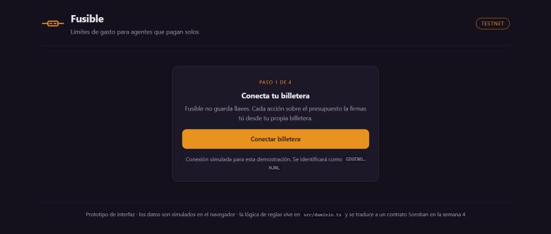
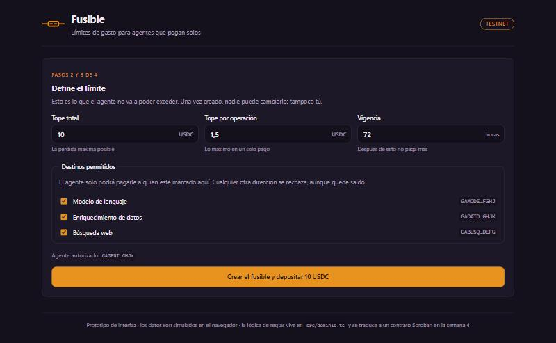
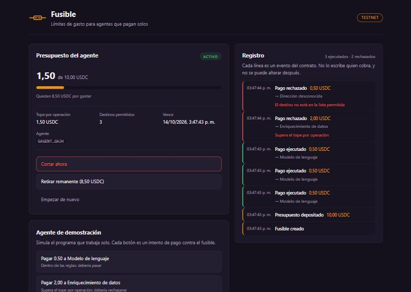
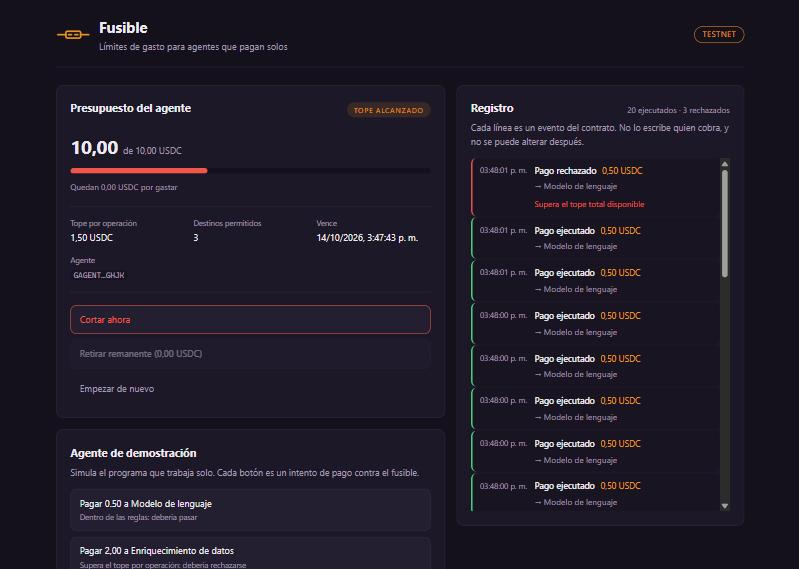

# Documentación — Semana 3 · Functional Proof

**Proyecto:** Fusible
**Repositorio:** [Pedronelbuiles/fusible](https://github.com/Pedronelbuiles/fusible)
**Red:** testnet

---

## Front construido

El front implementa el flujo principal del MVP definido en el Product
Blueprint: un responsable de presupuesto define un límite de gasto, lo
deposita, deja operando a un agente, ve lo que gasta mientras ocurre y puede
cortarlo en cualquier momento.

### Stack y cómo está organizado

Vite + React + TypeScript, sin dependencias más allá de React. La elección
responde a lo que el Blueprint ya había definido en la arquitectura: *"el
panel no mantiene base de datos propia"*. No hay nada que renderizar en
servidor porque todo lo que el panel muestra sale de la red y de la
billetera del usuario, así que un framework con servidor habría agregado
peso sin usarse.

```
frontend/src/
├── dominio.ts              reglas del fusible, sin React
├── App.tsx                 estado y orquestación del flujo
└── components/
    ├── Encabezado.tsx
    ├── Conectar.tsx        paso 1
    ├── CrearFusible.tsx    pasos 2 y 3
    ├── Panel.tsx           paso 4: estado, medidor y corte
    ├── ConsolaAgente.tsx   agente de demostración
    └── Historial.tsx       el registro
```

La decisión de diseño más importante es que **`dominio.ts` no sabe que
existe React**. Ahí viven las reglas —tope total, tope por operación, lista
de destinos, ventana de vigencia, estado— y la función `intentarPago`, que
valida en el mismo orden en que lo hará el contrato. No es un archivo de
utilidades: es el borrador ejecutable de la lógica que la semana 4 se
traduce a Rust. Que el front y la red apliquen las mismas reglas en el mismo
orden es lo que permite que la interfaz no mienta sobre lo que la red va a
hacer.

`intentarPago` tampoco muta el fusible: valida y devuelve un resultado, y
aplicar el cambio es un paso aparte. Esa separación imita el ciclo de
simular y luego enviar una transacción que vimos en la sesión 5.

### Las pantallas y su correspondencia con el Blueprint

| Vista | Paso del flujo de usuario | Qué resuelve |
|---|---|---|
| Conectar | 1 | El dueño se identifica. El producto no custodia llaves |
| Definir el límite | 2 y 3 | Tope total, tope por operación, destinos permitidos, vigencia, y depósito |
| Panel del presupuesto | 4, 7 y 8 | Gasto acumulado contra el tope, datos del límite, corte y retiro del remanente |
| Registro | 6 y 7 | Cada pago y cada intento rechazado, con su motivo |
| Agente de demostración | 5 | No es parte del producto: provoca los escenarios sin esperar |

**Paso 1 — Conectar.** La conexión es simulada en este prototipo; en el MVP
la resuelve Freighter. El texto es explícito en que Fusible no guarda llaves.



**Pasos 2 y 3 — Definir el límite y depositar.** El formulario reúne las
cuatro reglas. La advertencia *"una vez creado, nadie puede cambiarlo:
tampoco tú"* no es decorativa: es la propiedad que convierte el límite en
una regla y no en una promesa, y por eso se dice antes de crearlo.



**Paso 4 — Panel y registro.** El medidor muestra el gasto contra el tope.
A la derecha, cada movimiento: en verde los pagos ejecutados, en rojo los
rechazados con el motivo exacto. En la captura se ven los dos rechazos que
demuestran las reglas: uno por superar el tope por operación y otro por
pagar a un destino fuera de la lista.



**El escenario que sostiene el producto.** Cuando el gasto llega al tope, el
fusible deja de aprobar pagos sin que nadie intervenga: el estado cambia a
*Tope alcanzado*, la barra se pone roja y el siguiente intento se rechaza
con "supera el tope total disponible". Es la demostración de la hipótesis
del Problem Brief — la pérdida máxima estaba definida antes de empezar.



### Qué es real y qué está simulado

Los datos viven en el navegador: no hay red ni contrato todavía, porque esta
semana no corresponde. Lo que **sí** es real es la lógica de validación,
que se ejecuta de verdad contra cada intento de pago. El agente de
demostración permite provocar los tres casos —pago válido, monto excesivo y
destino no autorizado— además de dejarlo operando solo, que es el escenario
del video final.

La semana 4 sustituye el estado local por llamadas al contrato: `App.tsx`
cambia, `dominio.ts` se traduce a Rust y los componentes no se tocan.

---

## Decisión técnica

**Opción elegida: A — contrato propio.**

La sesión 5 dio cuatro preguntas para decidir entre lo nativo y un contrato,
y Fusible las responde sin ambigüedad:

| Pregunta | Respuesta |
|---|---|
| ¿Varias partes? | Sí. El dueño del presupuesto, el agente, el proveedor que cobra y quien audita necesitan la misma versión de lo ocurrido |
| ¿Mover un activo? | Sí, pero no alcanza. Un pago nativo mueve el dinero y no valida nada: no conoce topes, ni listas de destinos, ni gasto acumulado |
| ¿Condición simple? | No. Un saldo reclamable resuelve condiciones de tiempo o de quién cobra, pero no puede expresar "este pago cabe en lo que queda del tope" |
| ¿Reglas con estado? | **Sí.** El gasto acumulado cambia con cada pago y cada validación depende de ese estado. Es exactamente el caso que exige un contrato |

**Qué haría el contrato.** Guardar el presupuesto y los parámetros del
límite, y validar cada pago contra todas las reglas antes de ejecutarlo:
agente autorizado, destino en la lista, monto dentro del tope por operación,
acumulado más monto dentro del tope total, ventana vigente y fusible activo.
Ejecuta o rechaza, y emite el evento correspondiente. Además debe permitir
el corte inmediato e irreversible por parte del dueño y la devolución del
remanente.

**Por qué hace falta uno propio.** La sesión 5 también advirtió que un
contrato cuesta más que una operación: más renta, más tiempo y más riesgo, y
que conviene empezar por lo nativo. Lo intentamos y no alcanza. El
ingrediente que ninguna operación nativa ofrece es el **gasto acumulado
como estado consultable que condiciona la siguiente operación**. Sin eso no
hay tope, y sin tope no hay producto.

**Qué se descartó.** Usar una herramienta existente del ecosistema (opción
B). Lo que hay disponible resuelve mover valor, emitir activos o conectar
con moneda local; ninguna de esas piezas acota lo que un tercero autónomo
puede gastar. La parte que nos interesa es justamente la que no existe, y es
la razón por la que el proyecto tiene sentido.

Esto es coherente con el uso de Stellar declarado en el Blueprint:
contratos Soroban para las reglas, eventos del contrato para el registro,
Stellar RPC para consultar, SDK de JavaScript para el panel y Freighter para
la firma del dueño.

---

## Participación del equipo

El proyecto se desarrolla de forma **individual**, con autorización previa
del equipo académico.

| Integrante | GitHub | Aporte en este entregable |
|---|---|---|
| Pedro Nel Builes Moreno | [@Pedronelbuiles](https://github.com/Pedronelbuiles) | Todo: diseño de las vistas, lógica de reglas en `dominio.ts`, componentes, estilos, documentación y decisión técnica |

---

## Bloqueos y siguiente paso

**Lo que quedó pendiente.** El front trabaja contra estado local: no hay
contrato ni conexión a la red. Es lo previsto para esta semana, pero es la
distancia que falta para el MVP.

**Un hallazgo del desarrollo.** Durante las pruebas apareció un error que
duplicaba los eventos del registro: se estaba emitiendo el evento dentro de
la función que actualiza el estado, y React invoca esas funciones más de una
vez en desarrollo. Quedó corregido separando la validación del registro y
del cambio de estado — la misma separación que después exige el contrato
entre simular y enviar.

**Siguiente paso, en orden:**

1. Escribir el contrato `fusible` en Rust traduciendo `dominio.ts`, con las
   validaciones en el mismo orden.
2. Decidir la durabilidad del almacenamiento y quién extiende el TTL, según
   los tres cajones de la sesión 5. El estado del fusible es persistente: no
   se puede recrear.
3. Desplegarlo en testnet y anotar el identificador del contrato.
4. Reemplazar el estado local por llamadas al contrato vía Stellar RPC, y la
   conexión simulada por Freighter.
5. Validar con usuarios reales, que sigue pendiente desde la semana 1.

**Riesgo principal.** La curva de Rust y Soroban concentrada en una sola
semana. Se mitiga empezando por el contrato antes que por la integración:
un contrato desplegado y verificable en testnet ya es evidencia observable,
aunque el panel siga sin conectarse.
