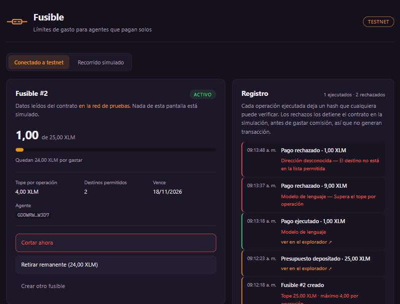

# MVP Funcional — Semana 4

**Proyecto:** Fusible
**Repositorio:** [Pedronelbuiles/fusible](https://github.com/Pedronelbuiles/fusible)
**Front desplegado:** <https://fusible101.vercel.app>
**Red:** Stellar testnet

---

## Evidencia verificable

Lo declarado en la semana 3 fue **opción A, contrato propio**. Está escrito,
desplegado y conectado al front. El ciclo completo —crear el fusible,
fondearlo, pagar, rechazar, cortar y retirar— ocurre contra la red, sin nada
simulado.

**Contrato:**
[CCDIWMOI…UWITZS35](https://stellar.expert/explorer/testnet/contract/CCDIWMOIELVUW77ZA5WEOPUHYYT6D36XIT7XGGU3NP6APTWMUWITZS35)
· [despliegue](https://stellar.expert/explorer/testnet/tx/577ffa9d5e25d3a3f6c739c23c6efd93d8e9f808b51a0f8836a8f2aa036e383c)

**El ciclo completo del fusible #2, ejecutado desde la interfaz:**

| # | Operación | Transacción |
|---|---|---|
| 1 | Crear el fusible con sus reglas | [0410833b…96bd7f](https://stellar.expert/explorer/testnet/tx/0410833b5df4f02af00ceeedb5bfa3e66e3161f34e69dcaf5ead28f6c196bd7f) |
| 2 | Depositar 25 XLM | [27788f7a…98bd55](https://stellar.expert/explorer/testnet/tx/27788f7a2434874289f54163f555db6f77358a4846e0eb285bc995f7e398bd55) |
| 3 | El agente paga 1 XLM a un destino permitido | [613fffe6…10526f](https://stellar.expert/explorer/testnet/tx/613fffe6b1bba6cff95e8523be97bf7cb000f84d9f03739370d41ed46710526f) |
| 4 | Pago de 9 XLM rechazado · tope por operación es 4 | *sin transacción (ver abajo)* |
| 5 | Pago a destino no autorizado rechazado | *sin transacción (ver abajo)* |
| 6 | El dueño corta el fusible | [980a0c9e…534157](https://stellar.expert/explorer/testnet/tx/980a0c9e05cbb0ae23336f490798bd8b4e53810ddc5e85930c2526878d534157) |
| 7 | Retiro del remanente: 24 XLM de vuelta | [99876aac…b87ac0](https://stellar.expert/explorer/testnet/tx/99876aac977703d2140c1a3cc420c601ce9ff06a6025e255e1b741d4b6b87ac0) |

**Video de demostración:** <!-- PENDIENTE: enlace de YouTube -->

### Cómo comprobarlo sin instalar nada

Abre <https://fusible101.vercel.app>, pulsa *Crear otro fusible*, define tus
propios topes y créalo. Verás dos transacciones reales. Después usa los tres
botones del agente: el primero paga, los otros dos los rechaza el contrato.

**Por qué los rechazos no tienen transacción.** El contrato los detiene
durante la simulación, antes de firmar: no se gasta comisión y no queda nada
en el explorador. Lo que sí queda es el código de error tipado —`#7` tope por
operación, `#6` destino no autorizado— que el front traduce y muestra. Es el
comportamiento correcto, pero significa que un bloqueo se reproduce, no se
enlaza.

---

## Aprendizajes y ajustes priorizados

> Qué aprendimos y qué cambiamos, ordenado por impacto y esfuerzo.

**El aprendizaje más caro fue de diseño.** El contrato se escribió primero
como *un contrato = un fusible*, siguiendo el modelo de instancias de la
sesión 5. Compiló, se desplegó y funcionó. Pero al conectarlo al front
apareció el problema: si cada fusible es un contrato, crear uno nuevo
significa desplegar, no llamar una función — y la funcionalidad que el
producto anuncia primero, que el dueño ponga el límite, quedaba fuera de la
interfaz. Se rehízo como **un contrato que administra muchos fusibles**, con
`create_fuse` devolviendo un identificador. El primer contrato sigue
desplegado; costó unas horas y la lección es que elegimos la arquitectura
sin contrastarla con el flujo de usuario del Blueprint.

**El segundo: el rechazo no deja rastro público.** Dábamos por hecho que un
intento bloqueado quedaría como evento del contrato, y es falso: si la
función devuelve error, la transacción revierte y los eventos se descartan.

**El tercero: la cadena de herramientas fue el verdadero riesgo**, no el
contrato. Rust en Windows exige un linker nativo y la toolchain MSVC pide
Visual Studio Build Tools, que no estaban. Se resolvió con la toolchain GNU.

| # | Ajuste | Impacto | Esfuerzo | Decisión |
|---|---|---|---|---|
| 1 | Contrato multi-fusible y creación desde el front | Alto | Grande | **Hecho** |
| 2 | Motivo del rechazo con el texto del contrato | Alto | Pequeño | **Hecho** |
| 3 | Enlace al explorador en cada operación | Alto | Pequeño | **Hecho** |
| 4 | Aviso durante los segundos de confirmación | Alto | Pequeño | **Hecho** |
| 5 | Medir el costo por invocación con `simulateTransaction` | Alto | Mediano | Pendiente |
| 6 | Firma del dueño con Freighter en vez de llave embebida | Alto | Grande | Después del cierre |
| 7 | Migrar los eventos a `#[contractevent]` | Bajo | Mediano | Pendiente |

---

## Riesgos y pendientes

> Lo que podría salir mal y lo que queda por resolver.

Aplicamos la revisión de cinco preguntas de la sesión 8.

**¿Dependemos de algo que no controlamos?** Sí, de tres cosas: la testnet, el
RPC público de Stellar y Vercel. Si el RPC no responde, el panel lo dice y
ofrece recargar; no se queda en blanco.

**¿Qué pasa si la testnet se reinicia?** El contrato desaparece y los enlaces
de esta página dejan de resolver. El despliegue se repite desde el
repositorio, pero el identificador cambia y hay que actualizar la variable de
entorno. **Es el riesgo más probable antes del Demo Day**, y es la razón de
que el recorrido simulado siga en el producto: si la red falla en vivo, la
demostración no se cae.

**¿Hay datos personales en la red?** No. Solo montos, direcciones y marcas de
tiempo.

**¿Quién guarda la llave del usuario?** El contrato no custodia ninguna. Las
llaves del dueño y del agente de demostración están embebidas en el bundle y
**cualquiera puede leerlas**: es intencional. Son fondos de prueba sin valor,
y sirve para demostrar el punto del producto — esas llaves son públicas y aun
así el agente no puede exceder el tope ni pagar a un destino no autorizado,
porque quien lo impide es el contrato. En producción el dueño firmaría con su
propia billetera y el agente desde su entorno.

**¿Qué pasa si una transacción falla?** El front distingue dos casos. Si una
regla la rechaza, muestra el motivo traducido del código de error. Si la red
no confirma en veinticinco intentos, avisa que no hubo confirmación.

### Pendientes declarados

1. **Los tests no se ejecutan localmente.** Están escritos —once casos que
   cubren las cinco reglas, el corte, el retiro y el aislamiento entre
   fusibles— pero el linker de mingw falla al construir el binario de pruebas
   en Windows (`export ordinal too large`). El `.wasm` compila sin problema.
   Se resuelve corriéndolos en CI sobre Linux.
2. **El costo por invocación sigue sin medir.** Es el dato que decidiría si
   el argumento de costo frente a AWS AgentCore existe o no.
3. **Cero entrevistas con usuarios.** Pendiente desde la semana 1.
4. El dueño firma con una llave embebida, no con Freighter.

---

## Plan de validación con usuarios

> A quiénes, con qué métodos, qué hipótesis y con qué criterio.

**A quién.** El usuario del Problem Brief: responsables de presupuesto
técnico con procesos automáticos en producción que consumen servicios de pago
por uso. Cinco personas, por red de contactos directa y por las comunidades
de desarrollo de Medellín. La prueba de que el público está bien definido es
poder nombrar diez personas concretas; hoy no puedo, y ese es el primer
trabajo.

**Hipótesis y criterios**, fijados antes de mirar resultados:

| # | Hipótesis | Tipo | Criterio |
|---|---|---|---|
| H1 | Creemos que un responsable de presupuesto **dejará operar un proceso sin supervisión si puede fijarle un tope**, porque hoy no lo suelta por miedo; lo sabremos si describe un caso concreto en que *no* automatizó algo por no poder acotar el gasto | Deseabilidad | 4 de 5 relatan al menos un caso |
| H2 | Creemos que **entenderá qué garantiza el tope sin que se lo expliquemos**, porque el panel lo muestra; lo sabremos si al ver la pantalla dice en sus palabras que el proceso no puede exceder ese monto | Usabilidad | 4 de 5 lo expresan sin ayuda |
| H3 | Creemos que **el registro independiente importa cuando hay que rendirle cuentas a un tercero**, porque hoy solo tiene el panel de su proveedor; lo sabremos si menciona espontáneamente un cliente, auditoría o jefe al ver el enlace al explorador | Deseabilidad | 3 de 5 lo mencionan sin que se les pregunte |
| H4 | Creemos que **aceptaría mover presupuesto a un activo digital**; lo sabremos si al preguntar qué tendría que ser cierto para probarlo, la objeción no es contable ni tributaria | Viabilidad | 3 de 5 — *es el supuesto que puede tumbar el proyecto* |

**Método.** Entrevista de 20 minutos y prueba de usabilidad sobre el front
desplegado. La tarea se plantea como escenario, no como instrucción:
*"tienes un proceso listo para trabajar el fin de semana y un monto que estás
dispuesto a arriesgar; déjalo operando"*. Se pide pensar en voz alta y no se
guía. Dos roles: una persona dirige y otra anota.

**Qué se registra.** Los cuatro campos de la sesión 8: qué hizo, qué dijo, en
qué paso y qué significa, separando observación de interpretación. Citas
textuales. Grabación solo con permiso.

**Métricas.** Completó el flujo sí/no, en qué paso abandonó, si pidió ayuda, y
cuántos leyeron el motivo del rechazo sin preguntar qué significaba.

**Cuándo.** Las dos semanas siguientes al cierre. Las entrevistas llevan
pendientes desde la semana 1 y son la deuda más grande del proyecto.

**Qué decisión se toma.** Con 4 o más, seguimos. Con 2 o menos, cambiamos algo
importante antes de construir más. Con 3, ajustamos y repetimos con otras
personas. Para H4: si cae, el proyecto necesita otro vertical o deja de tener
sentido como negocio.
