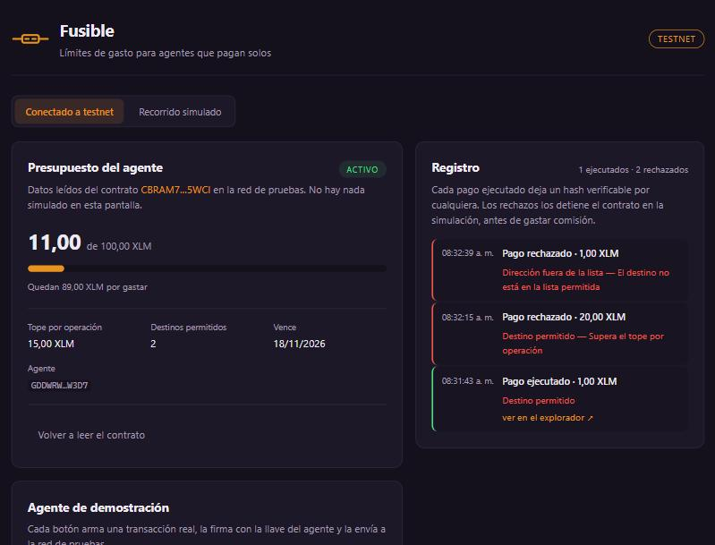

# MVP Funcional — Semana 4

**Proyecto:** Fusible
**Repositorio:** [Pedronelbuiles/fusible](https://github.com/Pedronelbuiles/fusible)
**Front desplegado:** <https://fusible101.vercel.app>
**Red:** Stellar testnet

---

## Evidencia verificable

Lo declarado en la semana 3 fue **opción A, contrato propio**. Está escrito,
desplegado y conectado al front.

| Qué | Enlace |
|---|---|
| **Contrato `fusible`** | [CBRAM7QF…ZGOK5WCI](https://stellar.expert/explorer/testnet/contract/CBRAM7QFZ4QJOSO7CVZGRYQ47I5UWOV4ZFB4TBV5DCG3KN22ZGOK5WCI) |
| Despliegue | [1d0c519b…bb47f6](https://stellar.expert/explorer/testnet/tx/1d0c519b98c0d41fc83c7dabb022cd442830032c0a0f37c44ba9112222bb47f6) |
| Creación del fusible (`init`) | [1b58bbbb…9a8569](https://stellar.expert/explorer/testnet/tx/1b58bbbbe0f808a7ace32528f5f0ea4780dbeb199dc82cdef762a8257e9a8569) |
| Depósito de 100 XLM (`fund`) | [dcbc1645…928285](https://stellar.expert/explorer/testnet/tx/dcbc1645b8de2d699ddfc411a11ea2008f0369fec2faf77b2d9079028a928285) |
| Pago del agente desde el CLI (`pay`) | [ce6164d5…779a00](https://stellar.expert/explorer/testnet/tx/ce6164d529e3c0a4603aaef92d0f7beb768a438ad2bb271ae8ee19940f779a00) |
| **Pago del agente desde el front** | [36b6d924…5d4e78](https://stellar.expert/explorer/testnet/tx/36b6d924ea32ebee16a9696c8582d5fd70d094ec20ab7b644f8116e2585d4e78) |

**Video de demostración:** <!-- PENDIENTE: enlace de YouTube -->

### Cómo comprobarlo sin instalar nada

Abre <https://fusible101.vercel.app>, deja la pestaña *Conectado a testnet* y
pulsa los tres botones del agente. El primero ejecuta un pago real y deja un
hash; los otros dos son rechazados por el contrato. Después abre el enlace del
contrato y verás que el gasto acumulado cambió.

**Un detalle sobre los rechazos:** no generan transacción pública. El
contrato los detiene durante la simulación, antes de firmar, así que no se
gasta comisión y no queda nada en el explorador. Lo que sí queda es el código
de error tipado —`#7` tope por operación, `#6` destino no autorizado— que el
front traduce y muestra. Es el comportamiento correcto, pero significa que la
evidencia de un bloqueo se reproduce, no se enlaza.

---

## Aprendizajes y ajustes priorizados

> Qué aprendimos y qué cambiamos, ordenado por impacto y esfuerzo.

**Lo que aprendimos construyendo.** Tres cosas, ninguna prevista.

La primera: **el rechazo no deja rastro público**. Dimos por hecho que un
intento bloqueado quedaría registrado como evento del contrato, y es falso —
si la función devuelve error, la transacción revierte y los eventos se
descartan. El registro de bloqueos vive del lado del cliente, no de la red.
Esto debilita uno de los argumentos del Problem Brief y hay que decirlo.

La segunda: **la cadena de herramientas fue el verdadero riesgo**, no el
contrato. Rust en Windows requiere un linker nativo; la toolchain MSVC exige
Visual Studio Build Tools, que no estaban. Se resolvió con la toolchain GNU.
Perdimos más tiempo ahí que escribiendo el contrato.

La tercera: **el costo real sigue sin medirse**. Era el pendiente declarado y
sigue abierto.

| # | Ajuste | Impacto | Esfuerzo | Decisión |
|---|---|---|---|---|
| 1 | Mostrar el motivo del rechazo con el texto del contrato, no un genérico | Alto | Pequeño | **Hecho** |
| 2 | Enlace al explorador en cada pago ejecutado | Alto | Pequeño | **Hecho** |
| 3 | Separar *Conectado a testnet* del *Recorrido simulado* | Medio | Pequeño | **Hecho** |
| 4 | Aviso de espera durante los ~5 s de confirmación | Alto | Pequeño | **Hecho** |
| 5 | Medir el costo por invocación con `simulateTransaction` | Alto | Mediano | Antes del cierre |
| 6 | Migrar los eventos a `#[contractevent]` (la API actual) | Bajo | Mediano | Pendiente |
| 7 | Crear y fondear el fusible desde el front con Freighter | Alto | Grande | Después del cierre |

---

## Riesgos y pendientes

> Lo que podría salir mal y lo que queda por resolver.

Aplicamos la revisión de cinco preguntas de la sesión 8.

**¿Dependemos de algo que no controlamos?** Sí, de tres cosas: la testnet, el
RPC público de Stellar y Vercel. Si el RPC no responde, el panel muestra "No
se pudo leer el contrato" y el botón de recargar; no se queda en blanco.

**¿Qué pasa si la testnet se reinicia?** El contrato desaparece y los enlaces
de esta página dejan de resolver. El despliegue se repite desde el
repositorio —el `.wasm` se reconstruye con `cargo build`— pero el *contract
id* cambia y hay que actualizar la variable de entorno. **Es el riesgo más
probable antes del Demo Day** y la razón de que el recorrido simulado siga
en el producto: si la red falla en vivo, la demostración no se cae.

**¿Hay datos personales en la red?** No. Solo montos, direcciones y marcas de
tiempo.

**¿Quién guarda la llave del usuario?** El contrato no custodia ninguna. La
llave del agente de demostración está embebida en el bundle del navegador y
**cualquiera puede leerla**: es intencional. Son fondos de prueba sin valor y
sirve para demostrar el punto del producto — esa llave es pública y aun así
no puede exceder el tope ni pagar a un destino no autorizado, porque quien lo
impide es el contrato. En producción el agente firmaría desde su propio
entorno.

**¿Qué pasa si una transacción falla?** El front distingue dos casos. Si la
regla la rechaza, muestra el motivo traducido del código de error. Si la red
no confirma en veinte intentos, avisa que no hubo confirmación a tiempo.

### Pendientes declarados

1. **Los tests del contrato no se ejecutan localmente.** Están escritos
   —nueve casos que cubren las cinco reglas, el corte y el retiro— pero el
   linker de mingw falla al construir la biblioteca de pruebas en Windows
   (`export ordinal too large`). El `.wasm` compila sin problema; es solo el
   binario de test. Se resuelve corriéndolos en CI sobre Linux.
2. **El costo por invocación sigue sin medir.**
3. **Cero entrevistas con usuarios.** Pendiente desde la semana 1.
4. Crear el fusible desde el front exige firma del dueño con Freighter; hoy
   el fusible se creó por CLI.

---

## Plan de validación con usuarios

> A quiénes, con qué métodos, qué hipótesis y con qué criterio.

**A quién.** El usuario del Problem Brief: responsables de presupuesto
técnico con procesos automáticos en producción que consumen servicios de pago
por uso. Cinco personas, reclutadas por red de contactos directa y por las
comunidades de desarrollo de Medellín. La prueba de que el público está bien
definido es poder nombrar diez personas concretas; hoy no puedo, y ese es el
primer trabajo.

**Hipótesis y criterios**, fijados antes de mirar resultados:

| # | Hipótesis | Tipo | Criterio |
|---|---|---|---|
| H1 | Creemos que un responsable de presupuesto **dejará operar un proceso sin supervisión si puede fijarle un tope**, porque hoy no lo suelta por miedo; lo sabremos si describe un caso concreto en que *no* automatizó algo por no poder acotar el gasto | Deseabilidad | 4 de 5 relatan al menos un caso |
| H2 | Creemos que **entenderá qué garantiza el tope sin que se lo expliquemos**, porque el panel lo muestra; lo sabremos si al ver la pantalla dice en sus palabras que el proceso no puede exceder ese monto | Usabilidad | 4 de 5 lo expresan sin ayuda |
| H3 | Creemos que **el registro independiente importa cuando hay que rendirle cuentas a un tercero**, porque hoy solo tiene el panel de su proveedor; lo sabremos si menciona espontáneamente un cliente, auditoría o jefe al ver el enlace al explorador | Deseabilidad | 3 de 5 lo mencionan sin que se les pregunte |
| H4 | Creemos que **aceptaría mover presupuesto a un activo digital**; lo sabremos si al preguntar qué tendría que ser cierto para probarlo, la objeción no es contable ni tributaria | Viabilidad | 3 de 5 — *es el supuesto que puede tumbar el proyecto* |

**Método.** Entrevista de 20 minutos seguida de prueba de usabilidad sobre el
front desplegado. La tarea se plantea como escenario, no como instrucción:
*"tienes un proceso listo para trabajar el fin de semana y un monto que estás
dispuesto a arriesgar; déjalo operando"*. Se pide pensar en voz alta y no se
guía. Dos roles: una persona dirige y otra anota, aunque el proyecto sea
individual — la segunda persona se consigue prestada.

**Qué se registra.** Los cuatro campos de la sesión 8: qué hizo, qué dijo, en
qué paso y qué significa, separando observación de interpretación. Citas
textuales. Grabación solo con permiso.

**Métricas.** Completó el flujo sí/no, en qué paso abandonó, si pidió ayuda,
y cuántos leyeron el motivo del rechazo sin preguntarnos qué significaba.

**Cuándo.** Las dos semanas siguientes al cierre del programa. Las entrevistas
llevan pendientes desde la semana 1 y es la deuda más grande del proyecto: no
hay una sola conversación con un usuario real.

**Qué decisión se toma.** Con 4 o más, seguimos y pasamos a la siguiente
hipótesis. Con 2 o menos, cambiamos algo importante antes de construir más.
Con 3, ajustamos y repetimos con otras personas. Para H4 en particular: si
cae, el proyecto necesita otro vertical o deja de tener sentido como negocio.
